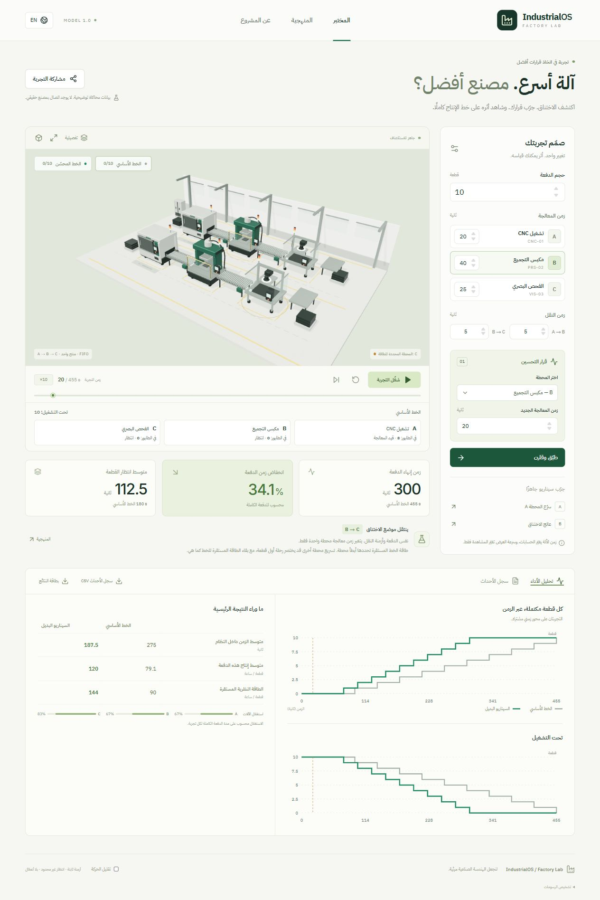

# IndustrialOS Factory Lab

[Hosted application](https://industrialos-factory-lab.snappytetra2.chatgpt.site) · [Verification status](docs/VALIDATION.md)

مختبر عربي وإنجليزي لتجربة أثر تحسين محطة واحدة على اختناق خط إنتاج ثلاثي المحطات. الحسابات تعليمية افتراضية؛ لا تمثّل مصنعًا حقيقيًا أو مواصفات معدات مصنّع.

A public, bilingual Arabic/English 3D experiment in production bottlenecks. The factory is an original procedural industrial illustration. Numerical results come from a deterministic serial-line model, not the renderer.



## Run locally

Requires a current Node.js version supported by Vite 7 (Node 22.12+ recommended) and npm.

```sh
npm ci
npm run dev
npm test
npm run build
npm run preview
```

The public deployment is a static `dist/` site. There is no server database, login, paid API, or runtime connection to external data. Fonts are bundled locally with their licenses.

## Structure

- `src/engine/`: pure simulation, snapshots, background worker, share URL validation, 73 numerical and contract tests.
- `src/components/FactoryScene.tsx`: original CNC, assembly press, inspection cell, conveyors, PBR materials, shared geometry and piece playback.
- `src/App.tsx`: experiments, input validation, synchronized playback, charts, bilingual interface, simplified fallback.
- `src/exports.ts`: Arabic/English PNG result card and UTF-8 event CSV.
- `public/docs/`: methodology, case study, asset credits and LinkedIn draft/storyboard.
- `public/fonts/`: self-hosted Google Fonts, SIL Open Font License files and source manifest.

The suite contains 78 tests: 73 engine/sharing tests and five tests for the pure CSV builder. Result cards open in an in-app preview with a download button; the final browser download still depends on the browser's download permissions. See the validation record for the checks actually completed.

## Reproduce the headline

10 pieces, A/B/C = 20/40/25 seconds, both conveyors = 5 seconds. Baseline finishes in **455 s**. A=10 gives **445 s**; B=20 gives **300 s**, a **34.1% decrease in batch completion time**. These are simulated outcomes, not real factory savings.

See [model](public/docs/MODEL.md), [case study](public/docs/CASE-STUDY.md), [validation](docs/VALIDATION.md), [LinkedIn material](public/docs/LINKEDIN.md), and [assets](public/docs/ASSETS.md).

## Scope

One product, three single-machine FIFO stations, fixed processing times, unlimited buffers, fixed-delay concurrent transport, all pieces released at time zero. No failures, setup, scrap, collisions or conveyor blocking. The renderer does not claim manufacturer-specific equipment fidelity.

## Deployment

The live application is hosted on Sites. To deploy your own copy, run `npm run build` and upload `dist/` to a static host. The simulation runs entirely in the browser and requires no API keys.

The build runner in `scripts/build.mjs` separates bundling and sequential minification into separate processes to reduce peak memory pressure on the 8 GB Windows development host. Use `npm run build` to preserve this process. Camera controls use Three.js OrbitControls directly with React Three Fiber.
